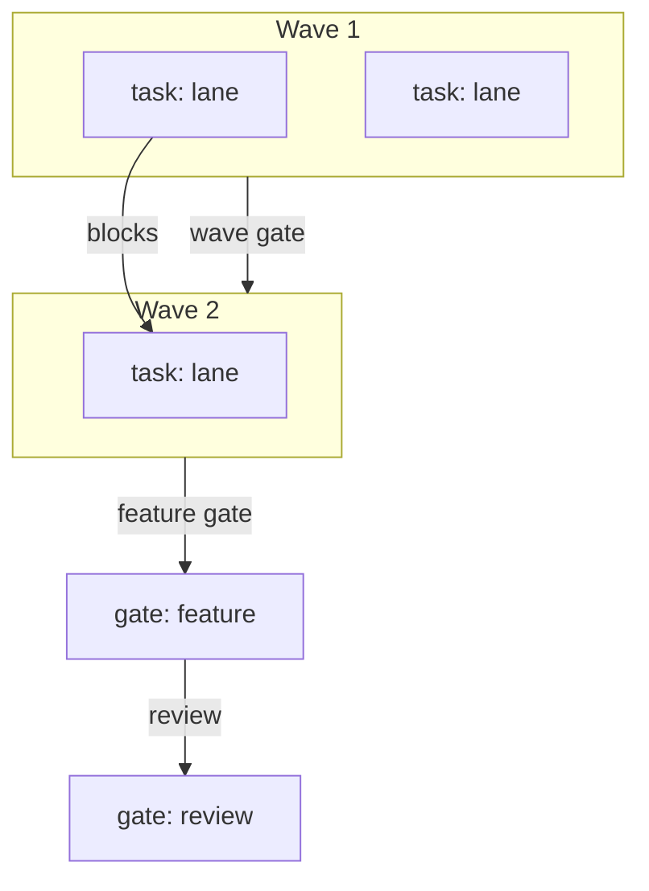

# <Program> plan

<Under ten lines. What changes, for whom, the rule the program enforces, and the PR ids in order.>

## How to read this

One box is one unit of work. Every box names the evidence that checks it. A nested box is a sub-step of the box above it. Check a box only when its evidence exists, a file, a log line, a screenshot, a test run, or a SHA. The body is a how-to. The appendices explain and record.

The program runs `skills/poteto-mode/playbooks/<execution playbook>.md`. <Who merges, and which PR ids are the operator's items that stop at merge-ready.>

Tests alone are not sufficient verification. A PR is verified only when its unit, live, and perf boxes are all checked.

## Verification readiness

| Field | Value |
|---|---|
| Decision | `exists` |
| Surface | `ui` |
| Drivability | `drivable` |
| Boundary | `none` |
| Evidence | `<launch command, ready signal, one journey, timestamp>` |
| Driver proof | `<one mapped journey plus one known-bad control at the head, or none>` |
| Isolation | `<single-stack at its fixed ports, or per-lane namespaces>` |
| Gate duration | `<unit, live, formal, perf in minutes; mark anything above 90 detached>` |
| Skill | `<verify-<app> path>` |
| Map | `<features/ path>` |
| Formal | `not-required` |
| Formal property | `none` |
| Maintenance route | `none` |
| Owner | `<role>` |

Fill `Maintenance route` only when the app `Decision` or `Formal` is `exists-stale`: name the `maintain-verification-skill` and/or `maintain-formal-verification-skill` route the stale decision routes to. Keep `none` otherwise.

`exists` requires a driver proof. A driver being rewritten, or one without a known-bad control, routes to `exists-stale` and the maintain skill. `Isolation` decides the plan's wave size. `Gate duration` above 90 minutes names a detached runner.

## Program checklist

### Arm the program

- [ ] State the protocol and this plan to the operator, then stop. Start execution only on the operator's explicit go.
- [ ] Read these from one source at program start. Re-read them at every tick. Use the remote checkout or the installed plugin.
  - [ ] `git show origin/main:skills/poteto-mode/playbooks/<execution playbook>.md`
  - [ ] `git show origin/main:skills/swarm/SKILL.md`
  - [ ] `git show origin/main:<control skill path>`
  - [ ] `git show origin/main:<verify-<app> skill path>`
  - [ ] `git show origin/main:<verify-<app> features/ map path>`
  - [ ] `git show origin/main:skills/poteto-mode/playbooks/opening-a-pr.md`
  - [ ] `git show origin/main:skills/<each other leaf skill the program uses>`
  - [ ] Installed plugin alternative. Replace each `git show origin/main:<path>` with `<installed plugin root>/<path>` and use those absolute paths everywhere in this program.
- [ ] On the operator's go, set the continuation.
  Continuation: <the profile's continuation mechanism, named from the active profile's Role mapping; a goal where the profile has `/goal`, a scheduler tick where it has one and no goal, an external cron where it has neither>. Where a goal exists, the merge-ready PR is the completion criterion; no background polling and no audit tick run under it.
- [ ] Use this tick prompt, verbatim. "Re-read the execution playbook from the source named in Arm the program. Audit the operation against it and fix drift in this tick. Probe every active lane and judge progress by side effects only. Stand down a stuck lane and dispatch its replacement now. Then post a short status message to the operator in chat only when the audit found a tracked change that no earlier status message reported, such as a PR opened, a code-ready head, a round launched or closed, a verdict, a merge, a stuck agent and the action taken, a blocker added or cleared, or a decision only the operator can make. Name every such change and nothing else. Do not repeat a table, the merged list, or an unchanged blocker. If the audit found none, end the turn with no reply text. Either way, log this tick's row in your decision trail. The row names the items reported, or none."
- [ ] On the operator's hold or stand-down, send every owner a zero-writes order at once.

### Spawn owners

- [ ] Spawn one owner per PR with the full lifecycle the execution playbook names.
- [ ] Follow this dependency graph. Start dependent work only after its parent merges, or base it on the parent branch when the execution playbook stacks.
  - [ ] <PR id> and <PR id> are independent and first. Both branch from `main`.
  - [ ] <PR id> after <PR id>.
  - [ ] Prefer a dedicated carrier PR that lands the verification or formal skill and its proof before the first gated PR. Use the folded forms below only when the carrier would ship no product change.
  - [ ] For `create-after-first-drivable-batch`, fold <creation task id> into the first wave of the last `ui`/`cli` PR of the first drivable batch. For `create-before-amendment`, fold it into the first wave of the amendment's first `ui`/`cli` PR. Use a `task:` node whose lane is the project skill folder glob `<project skill folder glob>`. The folded task ships the skill's proof, one green journey and one known-bad control, in the same PR.
  - [ ] For `create-before-amendment`, chart <carrier PR id> --> `[gate: verification]` --> <later `ui`/`cli` PR ids>. Later `ui`/`cli` PRs block on the gate; `library` and `backend` PRs do not.
  - [ ] For `Formal: create` or `exists`, chart <first covered-code PR id> --> `[gate: formal]` --> <later covered-code PR ids>. Fold formal creation into the first covered-code PR after its code is built and before its gate, with its mutants proving the check can fail.
- [ ] Hold the file boundaries. <PR id or class> touches only `<glob>`.
- [ ] Hold the review gate. <PR ids> change an interaction. They wait for the operator's review in chat with screenshots, and a video only when a lane's property lives in time, before merge.

### PR mechanics, for every PR

- [ ] Resolve the forge once. Default to `gh`; if `command -v origin` succeeds and Origin can resolve the repository, use `origin pr` for every PR operation. Record any fallback to `gh`. Never require `gt`.
- [ ] Open the PR ready, never draft, per **Opening a PR**. Use the run's built-in PR tool when it has one, else `origin pr create --status open --base <base-branch>` or `gh pr create --base <base-branch>` according to the resolved forge. A stack child targets its parent branch.
- [ ] Run the repo's lint and typecheck once before the PR-facing push. Push with hooks on.
- [ ] Run `/deslop` before each commit and `/no-comments` before review.
- [ ] Triage every Bugbot and security-reviewer comment per `../references/bugbot-triage.md`.
- [ ] Rebase onto current trunk before the code-ready report and babysit. Keep that merge base in fix rounds. Rebase again only at merge prep, on a `git merge-tree` conflict with trunk, or on a CI failure that comes from a change on trunk.

### Verdict and merge, for every PR

- [ ] A full swarm runs once, at the code-ready head. Another full swarm runs only for new behavior, a redesign, or a large new diff. A rebase, a merge-conflict resolution, or a minor fix gets a single verifier at the new head. Run each full swarm per `skills/swarm/SKILL.md`. One gates lane. The live lanes from the PR's **Verify, live** block. The formal check from its **Verify, formal** block when covered code changes. The perf lane from its **Verify, perf** block. Two or more audit lanes, each with its own focus, that read the diff and the receipts and distrust the PR body. The carrier PR's creation-task prove-once evidence joins its gate. The root audits the receipts in the merge-ready report before the verdict.
- [ ] Clean only when every lane is `PASS`. Findings go back to the owner, including a defect that a lane filed as a note. A new head gets a fresh verdict, except for results that stay valid under the patch-id rule in `skills/poteto-mode/playbooks/shipping.md`.
- [ ] <The merge or append rule from the execution playbook, with the patch-id rule from `skills/poteto-mode/playbooks/shipping.md`.>

### Boot recipe, for every live lane

Each live lane runs in its own git worktree at the PR head, checked out under the run's `.scratch/<feature-slug>/lanes/`. **One lane, one owner.** A lane is never bundled with another, and a child never carries two lanes. The plan names the wave size from the readiness `Isolation`. A single stack runs mutating lanes serially under the PR owner and lets only read-only asserts wave; per-lane namespaces allow a full wave. Run an asserted lane directly. Spawn a child only for exploration or for a check that has no scripted oracle yet. The lane worker is a runner, not a judge. It runs one asserted subcommand, saves the evidence, and reports the command, exit code, and evidence paths. The PR owner applies the predicate and owns the verdict. Each lane assertion ships with one known-bad control that fails; the lane is not a pass until that control fails. A gate expected above 90 minutes runs detached and reports its receipt path and exit code. The plan names the lane model in its `Model: swarm workers=<alias>` line; an asserted lane may use the fast tier, and the qualitative lanes keep the verdict with the owner. Follow the readiness `Skill` path and the lane's mapped feature entry through the project's `verify-<app>` skill. The skill wraps the repo's launch or e2e recipe and uses the detected UI driver (an existing Playwright harness first, then `playwright-cli` (`skills/playwright-cli`) or another browser/CDP recipe) for `ui`, and tmux/PTY for `cli`. A carrier PR's product lanes use the pre-existing drive path until the created skill passes its verification gate.

- [ ] `git fetch origin <head-branch> && git checkout <head SHA>`.
- [ ] <Start the shared stack once through the verify skill's launch recipe, or attach to the run's existing stack. Wait for the ready signal.>
- [ ] <Deliver the feature entry's journey under the lane's condition through the verify skill, which uses the detected UI driver (an existing Playwright harness or `playwright-cli` (`skills/playwright-cli`)) on UI surfaces or tmux/PTY on CLIs. Name the read-only diagnostics.>
- [ ] Save every screenshot or transcript to `.scratch/<feature-slug>/shots/<pr-id>/worker-<n>/<slug>.png` and return the paths with the report.

## Run graph

**Critical path.** <The longest blocking chain, named with its gates.>

**Staffing.** <role-to-model map per unit; critical-dev and reviewer independence; the model-family diversity rule. Outside auto mode this map is presented to the operator before the first wave.>

**Risk.** <the risk register with a fallback per risk and the verification ceiling.>

## <Task as a verb phrase> (<PR id>)

Surface: ui
Change: user-facing

**Depends on.** <PR id, or None.>

**Files.**

- [ ] Edit `<path>`.
- [ ] Create `<path>`.
- [ ] Delete `<path>`.

**Build.**

- [ ] <One change. Name the symbol and the file.>
- [ ] Map update. For this `Change: user-facing` PR, add or update the feature entry for every changed user-facing behavior under `<features/ path>` in the same PR. Give each changed user-facing feature at least one live lane. Omit this box for `Change: internal`.

**You see.**

- [ ] <One observable result, with the exact log line or screen state.>

**Verify, unit.** Tests alone are not sufficient verification. A PR is verified only when its unit, live, and perf boxes are all checked.

- [ ] <Test file and the case it gains.> Run `<command>`.

**Verify, live.** Tests alone are not sufficient verification. A PR is verified only when its unit, live, and perf boxes are all checked. Lanes on `<swarm workers model>` at the PR head, per the boot recipe. One lane is the trunk/head regression. Add one lane for every changed feature entry, and an extra condition only where the unit, formal, or performance evidence does not address the risk. There is no fixed lane count. Each lane names one feature entry, one journey under one condition, and a `Live-only:` sentence. Cover every changed user-facing feature at least once. Use extra conditions on existing entries for PR-specific probes; add a genuinely new journey's feature entry in the same PR.

- [ ] Lane 1. `<feature-id>#<sub-id>`. `Live-only: <the claim a mocked unit test cannot make>.` Regression lane against trunk. Drive the entry's load-bearing journey under <condition> at trunk and head. If trunk lacks the feature, record that and gate <the behavior the diff adds plus the end state the user waits for>. Save `<slug>.png`. Pass when <predicate>.
- [ ] Lane 2. `<feature-id>#<sub-id>`. `Live-only: <the claim a mocked unit test cannot make>.` <Drive this entry's journey under one condition.> Save `<slug>.png`. Pass when <predicate>.
- [ ] Lane 3. `<feature-id>#<sub-id>`. `Live-only: <the claim a mocked unit test cannot make>.` <Drive this entry's journey under one condition.> Save `<slug>.png`. Pass when <predicate>.

Add or remove lanes so every changed feature entry has at least one, and no lane repeats a condition another lane already covers.

**Verify, formal.** Tests alone are not sufficient verification. A PR is verified only when its unit, live, and perf boxes are all checked.

<Keep the four formal boxes for `Formal: create`, `exists`, or `exists-stale`. For `exists-stale`, name the `maintain-formal-verification-skill` route and owner in `## Verification readiness`, then run the maintained check in the Run box. For `Formal: not-required`, keep only the Not covered box. Delete whichever branch the PR's Formal decision does not use.>

- [ ] Command. `<command>`.
- [ ] Property. <One-sentence property.>
- [ ] Covered. <Paths and symbols.>
- [ ] Run. Save `<output evidence path>`. Pass when <predicate>. Advance the formal sync commit when the passing model still describes the code.
- [ ] Not covered.

**Verify, perf.** Tests alone are not sufficient verification. A PR is verified only when its unit, live, and perf boxes are all checked.

- [ ] Metric. <What is measured at both trunk and head. If trunk lacks the feature, also name the diff-added work and the end-to-end state the user waits for.>
- [ ] Probe. <The command or procedure, run at trunk and at the head, interleaved. Both sides must produce the metric.>
- [ ] Baseline. Record the trunk <value> first.
- [ ] Rule. <Head against trunk, with the number that fails. If the scenarios differ, add absolute budgets for the diff-added work and the user-visible end state instead of an invalid ratio.>

**Review gate.** The operator reviews before merge.

- [ ] Copy lane <n> screenshots into `<media path>/<pr-id>-review-<slug>.png`.
- [ ] Record a 30 to 60 second video only when a lane's property lives in time, such as ordering, stop on terminal, or focus movement. Save it as `<media path>/<pr-id>-review.mp4` when recorded; otherwise record none.
- [ ] Check map and formal drift. Open the feature map and the formal skill's coverage record independently. Every changed user-facing behavior has a feature-entry update, every lane's feature entry exists and matches its scenario, every named evidence path exists, and the formal sync commit covers the current covered code. A covered-code change without a rerun or sync update is a finding.
- [ ] Post the screenshots, and the video when one was recorded, in chat. Stop at merge-ready. Wait for the operator's click.

**Merge.**

- [ ] Root's clean verdict at the exact head SHA.
- [ ] Bugbot triage done.
- [ ] Formal-covered code has its required run and current sync commit; a missing run or model mismatch blocks merge.
- [ ] Rebased onto current trunk after the verdict, patch-id unchanged.
- [ ] <The owner squash-merges its own PR, or the root appends it to the base-branch stack and the operator lands it bottom-up.>

## Close the program

- [ ] Every box above is checked with its evidence.
- [ ] Every `Change: user-facing` PR has a checked Map update box and same-PR feature-entry updates for every changed user-facing behavior; every `Change: internal` PR has no map-update box.
- [ ] For `create-after-first-drivable-batch` or `create-before-amendment`, the `verify-<app>` skill exists and was proved once. Its prove-once transcript and one mapped feature are saved under `.scratch/<effort>/verification/<pr-id>/`, and its files merged before the creation task's worktree was removed.
- [ ] Reply to the operator with the report the execution playbook names.

## Appendix A. Prototype evidence

<Each open question a prototype answered, with the branch, the SHA, and the artifact links. Each question that stays unproven.>

## Appendix B. Alternatives rejected

<Each approach weighed and why it lost.>

## Appendix C. Risks

<Each risk with the PR it lands in and what the owner watches.>

## Appendix D. Links and reading list

<Docs to read before editing. Which PRs get `skills/how/SKILL.md` and `skills/interrogate/SKILL.md`. The trail per `skills/show-me-your-work/SKILL.md`.>
