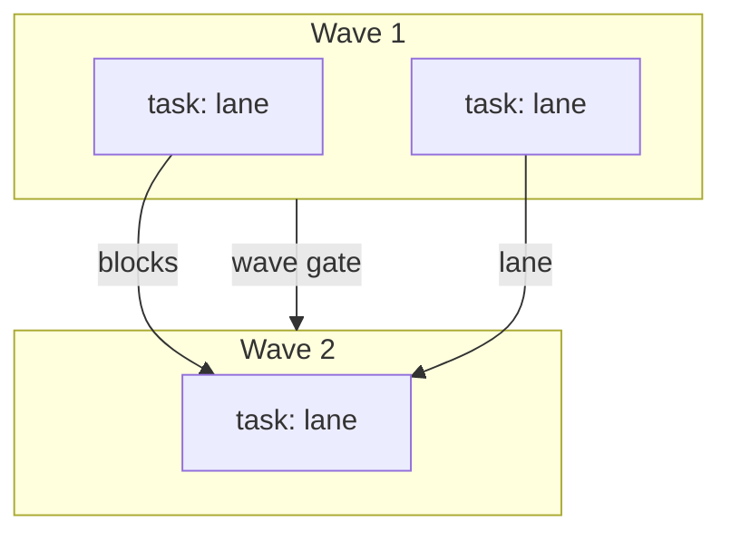

# Run graph

The plan lead charts the run graph before execution. It lives in the plan's `## Run graph` block, in the Mermaid shape `check-plan` validates.

## Format

- **Nodes.** A `pr:` or `feature:` node per PR or feature; a `task:` node per atomic task, labeled with its id and file lane. A gate node per wave gate, plus the feature gate and the review gate.
- **Edges.** `-->|blocks|` for a blocking dependency; `-->|lane <glob>|` for a file-lane collision. Both serialize.
- **Waves.** Each `subgraph W<n>` is one wave of tasks that run in parallel.
- **Critical path.** Named in prose under the graph: the longest blocking chain, with its gates.

## Rules the checker enforces

- The graph block exists and parses as `graph TD` with at least one task node.
- Every task node carries a lane.
- Every wave subgraph has a wave-gate edge leaving it, or feeds the feature gate.
- The feature gate and the review gate nodes are present.
- The graph is acyclic.

## Rules that stay judgment

Decomposition quality, whether a lane split is right, whether a task is truly atomic, and the critical path's naming are the plan lead's judgment. The checker proves structure, not design.

## Re-planning

A design or spec change re-charts the graph, updates the plan, and re-enters the approval gate. The prior graph stays in git history; the plan carries the new one and a one-line note that it re-charted.
