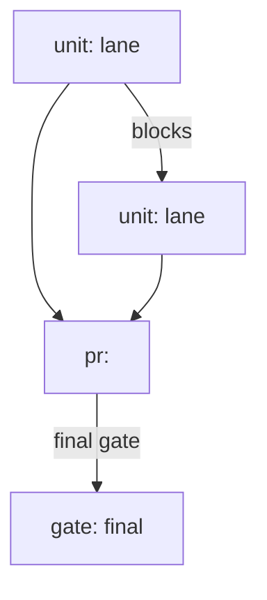

# Run graph

The plan lead charts the run graph before execution. It lives in the plan's `## Run graph` block, in the Mermaid shape [`plan-shape.mjs`](plan-shape.mjs) defines and `check-plan.mjs` validates.

## Format

- **Nodes.** One `pr:` node, one `unit:` node per unit, each carrying its file lane, and one `[gate: final]`. A `Formal: create` or `Formal: exists` decision adds `[gate: formal]`; a review above the depth threshold may add `[gate: review]`, and neither replaces the final gate.
- **Edges.** `-->|blocks|` for a dependency; `-->|lane <glob>|` for a file-lane collision. Both serialize the pair. Two units may share a lane only when an edge orders them.
- **Ready set.** Every unit whose dependencies are merged and whose file lane is disjoint from the other units in that set. Disjointness is scoped to a ready set, not to the whole plan.
- **Critical path.** Named in prose under the graph: the longest blocking chain, with its gates.

## Readiness-driven nodes

The plan's `## Verification readiness` decision selects these. With no decision requiring them, they stay out.

- **Skill creation.** `create-before-amendment` or `create-after-first-drivable-batch` adds one `unit:` node for the creation, lane = the project skill folder glob. Before-amendment puts it in the first ready set. After-first-drivable-batch puts it after the first unit that makes the app drivable. Every later unit that needs the skill declares a `blocks` edge from the creation unit; that edge replaces the old verification gate.
- **Skill repair.** `exists-stale` makes the repair the first unit, and every later unit that needs the skill declares the dependency.
- **Formal creation.** `Formal: create` adds one `unit:` node that builds the check, placed before the last unit that changes covered code.
- **Formal gate.** `Formal: create` or `Formal: exists` adds `[gate: formal]` after that unit or after the PR node; the final gate runs it.

## Rules the checker enforces

- The block exists and parses as `graph TD` with at least one unit node.
- Exactly one `pr:` node, and every unit node carries `unit: <id> lane <glob>`.
- `[gate: final]` is present; a gate is named `final`, `review` or `formal`.
- Wave subgraphs are rejected by name.
- The graph is acyclic.
- A `**Critical path.**` line is present.

## Rules that stay judgment

Decomposition quality, whether a lane split is right, whether a unit is atomic, and the critical path's naming are the plan lead's judgment. The checker proves structure, not design.

## Re-planning

A design or spec change re-charts the graph, updates the plan, and re-enters the approval gate. The prior graph stays in git history; the plan carries the new one and a one-line note that it re-charted. A readiness change (`exists-stale` maintenance, a deferred creation becoming due) re-charts too, by the same rule.
