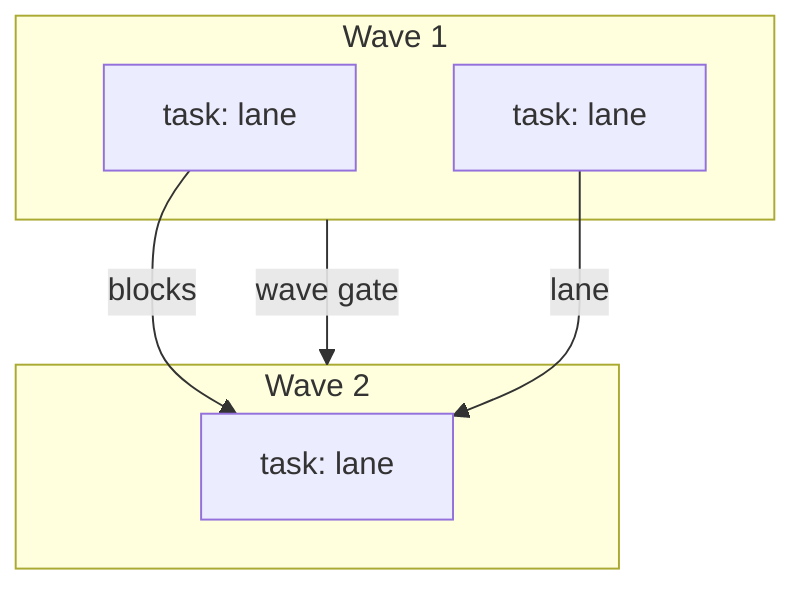

# Run graph

The plan lead charts the run graph before execution. It lives in the plan's `## Run graph` block, in the Mermaid shape `check-plan` validates.

## Format

- **Nodes.** A `pr:` or `feature:` node per PR or feature; a `task:` node per atomic task. Every task, pr, and feature node carries a lane. A gate node per wave gate, plus the feature gate, the review gate, and the readiness-driven gates below.
- **Edges.** `-->|blocks|` for a blocking dependency; `-->|lane <glob>|` for a file-lane collision. Both serialize.
- **Waves.** Each `subgraph W<n>` is one wave of tasks that run in parallel.
- **Critical path.** Named in prose under the graph: the longest blocking chain, with its gates.

## Readiness-driven nodes

The plan's `## Verification readiness` decision selects these; with no decision requiring them, they stay out.

- **Creation task.** A `create-after-first-drivable-batch` or `create-before-amendment` app-skill decision adds a folded `task:` node inside the carrier PR's first wave, lane = the project skill folder glob. The carrier PR node itself is unchanged. New project: the carrier is the last `ui`/`cli` PR of the first drivable batch. Existing project: the carrier is the first `ui`/`cli` PR of the amendment.
- **Verification gate.** `create-before-amendment` only, existing projects: the carrier `pr:` node `-->|verification gate| VG[gate: verification]`, and `VG -->|blocks|` every later `ui`/`cli` PR node. `library`/`backend` PR nodes take no edge from it.
- **Formal gate.** A `Formal: create` or `exists` decision: the first covered-code `pr:` node `-->|formal gate| FMG[gate: formal]`, and `FMG -->|blocks|` every later covered-code PR node.

## Rules the checker enforces

- The graph block exists and parses as `graph TD` with at least one task node.
- Every task, pr, and feature node carries a lane.
- Every wave subgraph has a wave-gate edge leaving it, or feeds the feature gate.
- The feature gate and the review gate nodes are present.
- A `create-*` readiness decision carries the folded creation task node in the carrier PR's first wave, with its lane.
- `create-before-amendment` carries a `[gate: verification]` node fed by the carrier, with an edge into at least one later `ui`/`cli` PR.
- A `Formal: create` or `exists` decision carries a `[gate: formal]` node fed by the first covered-code PR, blocking every later covered-code PR.
- The graph is acyclic.

## Rules that stay judgment

Decomposition quality, whether a lane split is right, whether a task is truly atomic, and the critical path's naming are the plan lead's judgment. The checker proves structure, not design.

## Re-planning

A design or spec change re-charts the graph, updates the plan, and re-enters the approval gate. The prior graph stays in git history; the plan carries the new one and a one-line note that it re-charted. A readiness change (`exists-stale` maintenance, a deferred creation becoming due) re-charts too: the same rule, the same note.
