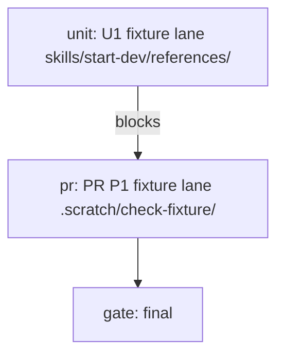

# Fixture plan

A fixture used to prove the checker and the emitter.

## How to read this

One box is one unit of work. Every box names the evidence that checks it. Check a box only when its evidence exists. The run executes `skills/start-dev/playbooks/single-pr.md`.

Tests alone are not sufficient verification. A PR is verified only when its unit, live, and perf boxes are all checked.

## Verification readiness

| Field | Value |
|---|---|
| Decision | `create-before-amendment` |
| Surface | `cli` |
| Drivability | `drivable` |
| Boundary | `none` |
| Evidence | `node emit-plan --help` reached the ready state on journey demo at 2026-10-29 |
| Driver proof | one mapped journey plus a known-bad control |
| Isolation | single-stack at its fixed ports |
| Gate duration | unit 1, live 2, formal 1, perf 1 |
| Skill | `skills/verify-gfunc/SKILL.md` |
| Map | `skills/verify-gfunc/features/README.md` |
| Formal | `create` |
| Formal property | The checker reports every mutated rule with its location |
| Maintenance route | `none` |
| Owner | `main agent` |

## Run graph

**Critical path.** U1 blocks P1, and P1 reaches the final gate.

## Fixture change (PR P1)

Surface: cli
Change: internal

**Depends on.** None.

**Files.**

- [ ] Create `skills/start-dev/references/plan-shape.mjs`.

**Build.**

| Unit | Deliverable | File lane | Worktree | Scoped tests | Depends on |
|---|---|---|---|---|---|
| U1 | fixture | skills/start-dev/references/ | .scratch/check-fixture/w1/u1 | node --test fixture | None |

- [ ] Write the fixture change.

**You see.**

- [ ] The checker prints 0 problems.

**Verify, unit.** Tests alone are not sufficient verification. A PR is verified only when its unit, live, and perf boxes are all checked.

- [ ] Run `node --test fixture`.

**Verify, live.** Tests alone are not sufficient verification. A PR is verified only when its unit, live, and perf boxes are all checked. Lanes on `model` at the PR head.

- [ ] Lane 1. `fixture#emit`. `Live-only: a real emit renders a real file.` Regression lane on trunk and head. Log `.scratch/check-fixture/lane-1.txt`. Pass when the exit is 0.

**Verify, formal.** Tests alone are not sufficient verification. A PR is verified only when its unit, live, and perf boxes are all checked.

- [ ] Command. `node --test fixture`.
- [ ] Property. The checker reports the mutated rule with its location.
- [ ] Covered. `skills/start-dev/references/plan-shape.mjs`.
- [ ] Run. Save `.scratch/check-fixture/formal.txt`. Pass when every mutant is reported.

**Verify, perf.** Tests alone are not sufficient verification. A PR is verified only when its unit, live, and perf boxes are all checked.

- [ ] Metric. Checker wall time.
- [ ] Probe. Run the checker at trunk and head.
- [ ] Baseline. Record the trunk time first.
- [ ] Rule. The head is no more than twice the trunk.

**Review gate.** The operator reviews before merge.

- [ ] The independent reviewer and the operator read the evidence.

**Merge.**

- [ ] Squash-merge on a clean verdict and green CI on the merge result.

## Close the run

- [ ] Every unit in the lane table is merged with its scoped tests green.

## Appendix A. Prototype evidence

The fixture itself.
